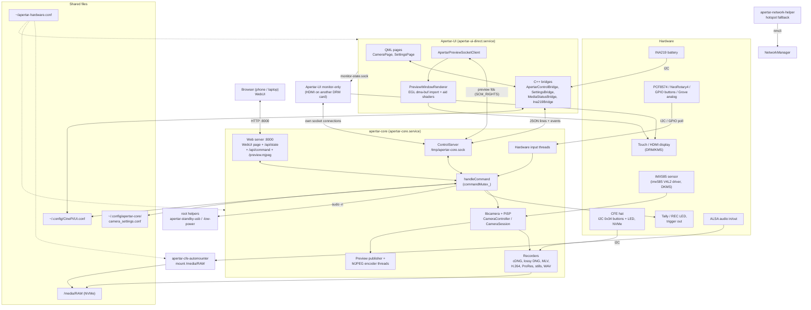
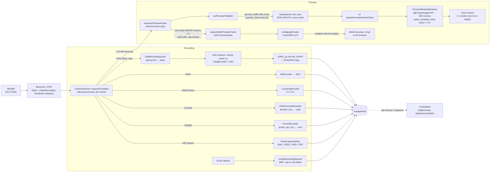
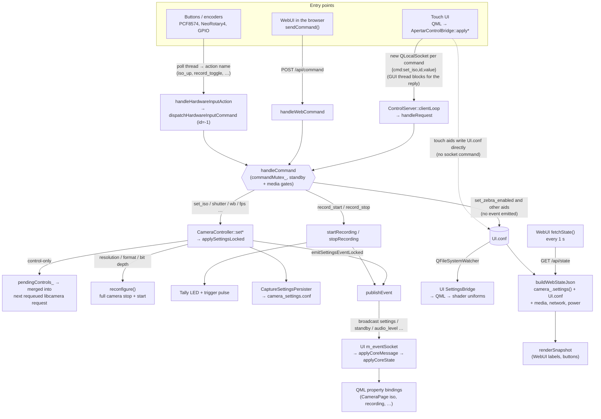

# Diagrams: architecture, image path, control path

Mermaid views of [overview.md](overview.md), [core.md](core.md), [ui.md](ui.md) and the traces in
[../llm/flows.md](../llm/flows.md). Refs are against `upstream-1.6.0`, like those pages. The diagrams
leave out detail; follow the links for `path:line`. Renders in Obsidian and on GitHub.

## 1. Processes and channels

Startup order (readiness files, not systemd `After=`): UI loads `Main.qml` → writes
`/run/apertar-ui/core-start-ready` → Core's `ExecStartPre` gate (≤8 s) → Core opens the camera, then
binds the socket, then starts the WebUI and the hardware inputs. See
[overview.md](overview.md#startup-order-and-readiness-files).

## 2. Image data

Two branches leave `requestComplete` for every frame: the preview (touch screen and WebUI) and
the recording. Recording is RAW (DNG/MLV) or processed YUV/RGB (H.264/ProRes), never both.

Notes:
- The touch preview is zero-copy: the UI renders straight from Core's dma-bufs. The WebUI preview is
  a CPU copy, downsampled and JPEG-encoded in Core, and costs nothing while no browser watches.
- The aids (zebra, peaking, false colour) exist only in the UI's shaders. The WebUI image has none.
- Trace with line refs: [flows.md A4](../llm/flows.md) (preview), A2 (record write path).

## 3. Controls and state

Three entry points (touch UI, WebUI, hardware buttons/encoders) converge on one function,
`handleCommand`. State comes back three different ways: a broadcast `settings` event (UI), a 1 s
poll of `/api/state` (WebUI), and the `UI.conf` file (UI-side settings such as aids).

Notes:
- The WebUI never receives socket events; it only sees changes on its next poll. A touch ISO change
  reaches the browser within about 1 s.
- A WebUI aid toggle reaches the touch screen only through `UI.conf` and the file watcher
  ([flows.md A3](../llm/flows.md)).
- `settingsBody`, `settingsEvent` and `buildWebStateJson` are three hand-written copies of the same
  fields (**confirmed in code**): a new setting has to be added to all three
  ([change-recipes.md](../llm/change-recipes.md)).
- Hardware-input commands run on the poll thread; a failure only reaches stderr.
- This rig has no IMU, so the gyro recorder and the UI level never run here, though the code has them.
