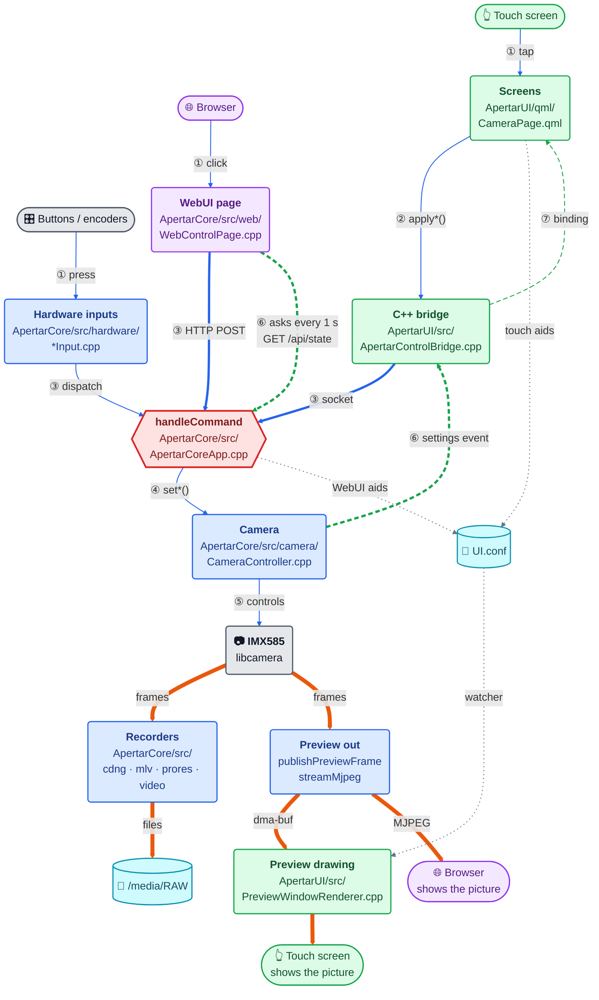
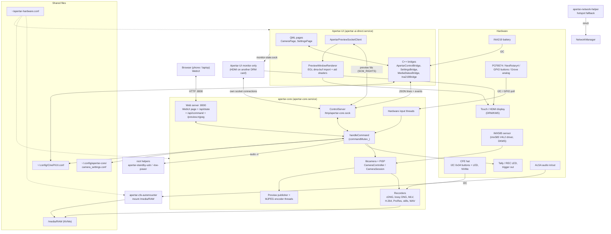
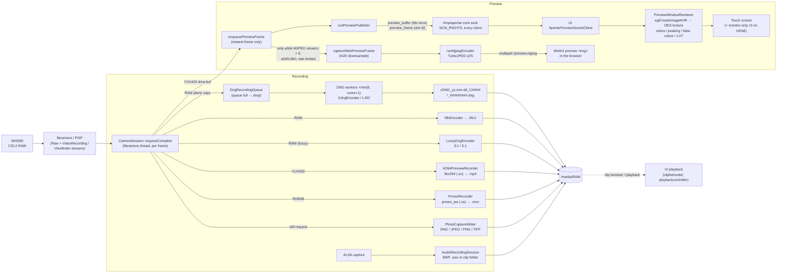
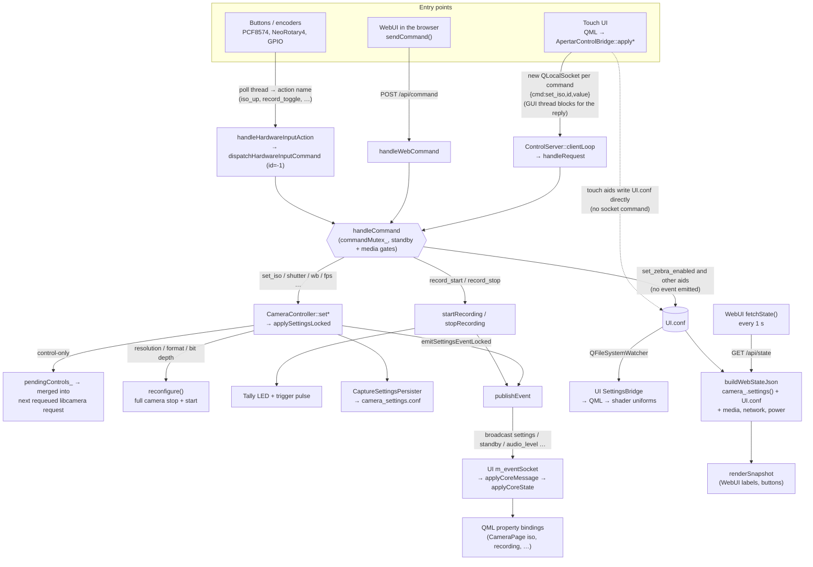

# Diagrams: architecture, image path, control path

Start with §0. Mermaid views of [overview.md](overview.md), [core.md](core.md), [ui.md](ui.md) and the traces in
[../llm/flows.md](../llm/flows.md). Refs are against `upstream-1.6.0`, like those pages. The diagrams
leave out detail; follow the links for `path:line`. Renders in Obsidian and on GitHub.

## 0. Start here: the coding map

Interactive version (click boxes and arrows, step through flows): https://tiramisioux.github.io/apertar-coding-map/
(public; source and master copy: `~/Documents/Apertar/apertar-coding-map`, GitHub `Tiramisioux/apertar-coding-map`).

One picture for working on the code yourself. Every box names the file you open.

**How to read it**
- 🟩 green box = **Apertar-UI** repo (`~/ApertarUI`), 🟦 blue = **Apertar-Core** repo (`~/ApertarCore`),
  🟪 purple = the **WebUI** (its HTML/JS is a C++ string *inside Core*), ⬜ grey = hardware,
  🟦 cyan cylinder = a file on disk, 🟥 red hexagon = the one place every command passes.
- **Top to bottom** = the order things happen: you → front ends → the hub → camera → picture out → where it ends up. The people are at the top (you act)
  and again at the bottom (you see the picture). Every path starts with its repo.
- **Arrows: colour = what moves, line = how it travels.**

  | Line | Means | Example |
  | --- | --- | --- |
  | thin blue ─── | a command, as a **function call** inside one program | ② `apply*()`, ④ `camera_.set*()` |
  | **thick blue ━━━** | a command as a **message between programs** (socket or HTTP): change both ends, they must agree on the field names | ③ `set_iso` on the socket, `POST /api/command` |
  | thin green dashed ╌╌╌ | new state coming back **inside one program** | ⑦ `Q_PROPERTY` → QML binding |
  | **thick green dashed ╍╍╍** | new state coming back **between programs** | ⑥ `settings` event (Core *pushes* to the UI); `GET /api/state` (the WebUI *asks* every 1 s, so that arrow points at Core) |
  | **very thick orange ━━━** | pictures (heavy data, every frame) | frames → recorders, preview |
  | thin grey dotted ┈┈┈ | settings handed over **through a file**, not a message | `UI.conf` |

  Rule of thumb: a **thick** arrow is where you cross a boundary. That is where a typo in a
  field name fails silently, so check both sides.



**What travels on each arrow: one ISO change to 800, followed through the code**

The numbers match the arrows. JSON is shortened with `…`. The full trace with line refs is
[flows.md A1](../llm/flows.md).

| Step | Arrow | Kind | What it looks like in the code |
| --- | --- | --- | --- |
| ① | tap → Screens | touch | `CameraPage.qml`: `root.controlBridge.applyIso(v)` |
| ② | Screens → C++ bridge | function call | `ApertarControlBridge::applyIso("800")` → `sendCoreCommand(...)` |
| ③ | bridge → hub | **Unix socket** `/tmp/apertar-core.sock`, one JSON line | `{"cmd":"set_iso","id":7,"value":"800"}\n` |
| ③ | WebUI → hub | **HTTP** | `POST /api/command` with body `{"cmd":"set_iso","value":"800"}` (`sendCommand(...)` in the page JS) |
| ③ | buttons → hub | function call on the poll thread | `apertar-hardware.conf`: `encoder0_cw=iso_up` → `dispatch("set_iso", …)` |
| hub | inside `handleCommand` | if-branch | `if (command.name == "set_iso") { camera_.setIso(value); … }` |
| ④ | hub → Camera | function call | `CameraController::setIso(800)` → `AnalogueGain = max(1, iso / 100)` = 8.0 |
| ⑤ | Camera → sensor | libcamera control | `request->controls().merge(pendingControls_);` (lands one frame later) |
| ⑥ | Camera → bridge | **socket event**, pushed to every client | `{"event":"settings",…,"iso":800,"iso_auto":false,…}` |
| ⑥ | WebUI → hub | **HTTP poll**, every 1 s | `GET /api/state` → `{…,"iso":800,"iso_auto":false,…}` |
| ⑦ | bridge → Screens | Qt property | `setIso("800")` emits `isoChanged` → QML `function onIsoChanged()` |
| preview | Preview out → UI | **socket + file descriptors** (`SCM_RIGHTS`) | once per buffer: `{"event":"preview_buffer",…}` + fds; then each frame `{"event":"preview_frame","slot":2,…}` |
| preview | Preview out → browser | **HTTP stream** | ``, multipart JPEG |
| file | anyone → `UI.conf` | **INI file**, file-watched | `[General]` / `zebraEnabled=true` |

Try ③ and ⑥ yourself from the Mac (the same calls the WebUI makes; values are strings because
Core's parser is flat):

```bash
curl -s -m 5 http://apertar.local:8000/api/state | grep -o '"iso":[0-9]*'
```

```bash
curl -s -m 5 -X POST http://apertar.local:8000/api/command -d '{"cmd":"set_iso","value":"800"}'
```

(The second one changes the camera. The note "manual-addendum talk-to-core" has more.)

**Where your change goes** (follow the arrows; each row is one of them)

| You want to… | Touch these, in arrow order | Don't forget |
| --- | --- | --- |
| Add a control on the touch screen for an existing camera setting | `QML` → bridge `apply*()` | The command already exists: grep `command.name == "set_` in `ApertarCoreApp.cpp` |
| Add a new camera setting | `handleCommand` branch → `CameraController::set*` → `controlsForSettings` | State goes back in **three** hand-written copies: `settingsBody`, `settingsEvent`, `buildWebStateJson` ([change-recipes.md](../llm/change-recipes.md)) |
| Show it in the WebUI | `WebControlPage.cpp` (`renderSnapshot`, `sendCommand`) | Core must be rebuilt: the page is compiled into it |
| Map a button or encoder to it | `handleSingleHardwareInputAction` + `normalizeAction` in each `*Input.cpp` | Config is read once: restart Core |
| Change how the preview looks (aid, overlay) | `PreviewWindowRenderer.cpp` shader + `CameraPreviewItem` | Aids live in `UI.conf`, not in Core's state |
| Change what is written to disk | `src/cdng/…` or the recorder in `CameraController.cpp` | Never build while a take runs |

Rebuild after a change: UI `cmake --build ~/ApertarUI/build`, Core `cmake --build ~/ApertarCore-build -j2`,
then restart the matching service ([build.md](build.md#quick-reference)).

## 1. Processes and channels



Startup order (readiness files, not systemd `After=`): UI loads `Main.qml` → writes
`/run/apertar-ui/core-start-ready` → Core's `ExecStartPre` gate (≤8 s) → Core opens the camera, then
binds the socket, then starts the WebUI and the hardware inputs. See
[overview.md](overview.md#startup-order-and-readiness-files).

## 2. Image data

Two branches leave `requestComplete` for every frame: the preview (touch screen and WebUI) and
the recording. Recording is RAW (DNG/MLV) or processed YUV/RGB (H.264/ProRes), never both.



Notes:
- The touch preview is zero-copy: the UI renders straight from Core's dma-bufs. The WebUI preview is
  a CPU copy, downsampled and JPEG-encoded in Core, and costs nothing while no browser watches.
- The aids (zebra, peaking, false colour) exist only in the UI's shaders. The WebUI image has none.
- Trace with line refs: [flows.md A4](../llm/flows.md) (preview), A2 (record write path).

## 3. Controls and state

Three entry points (touch UI, WebUI, hardware buttons/encoders) converge on one function,
`handleCommand`. State comes back three different ways: a broadcast `settings` event (UI), a 1 s
poll of `/api/state` (WebUI), and the `UI.conf` file (UI-side settings such as aids).



Notes:
- The WebUI never receives socket events; it only sees changes on its next poll. A touch ISO change
  reaches the browser within about 1 s.
- A WebUI aid toggle reaches the touch screen only through `UI.conf` and the file watcher
  ([flows.md A3](../llm/flows.md)).
- `settingsBody`, `settingsEvent` and `buildWebStateJson` are three hand-written copies of the same
  fields (**confirmed in code**): a new setting has to be added to all three
  ([change-recipes.md](../llm/change-recipes.md)).
- Hardware-input commands run on the poll thread; a failure only reaches stderr.
- This rig has no IMU, so the gyro recorder and the UI level never run here, though the code has them.
