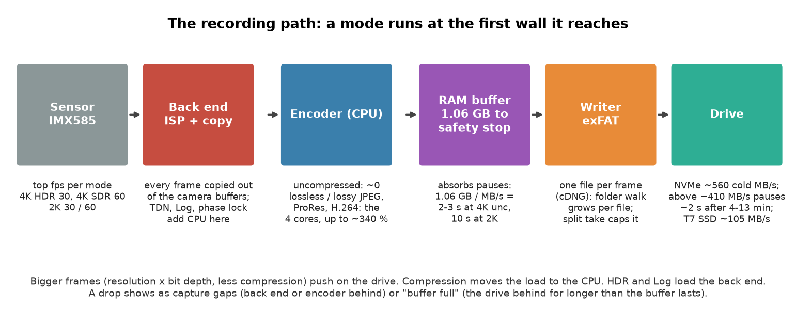
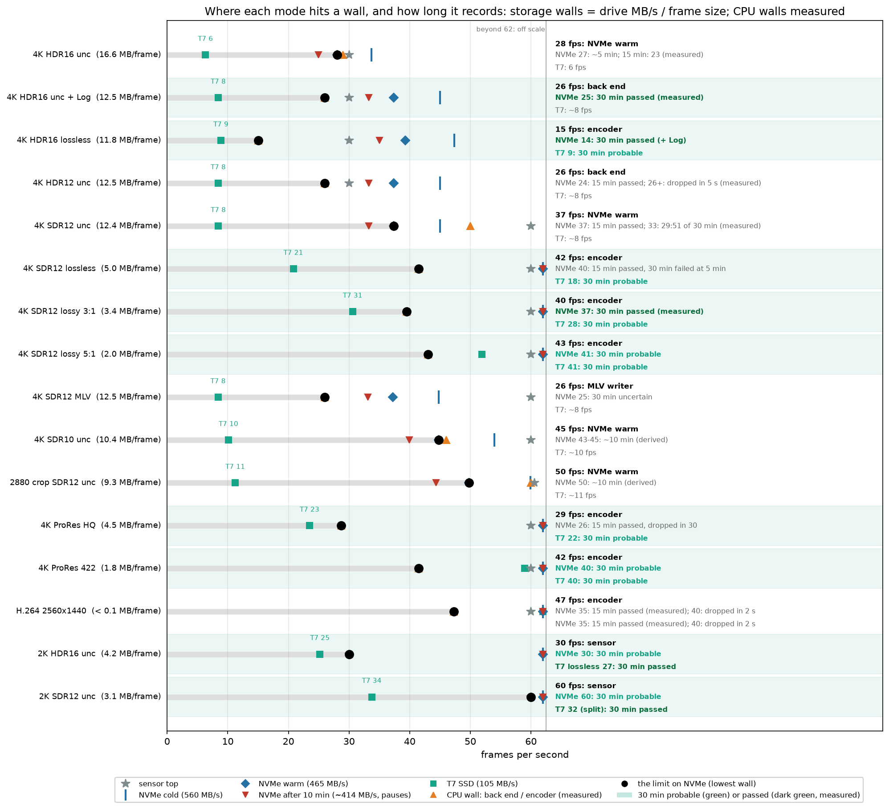
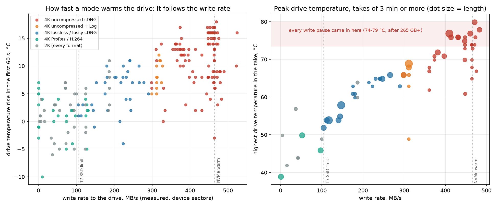
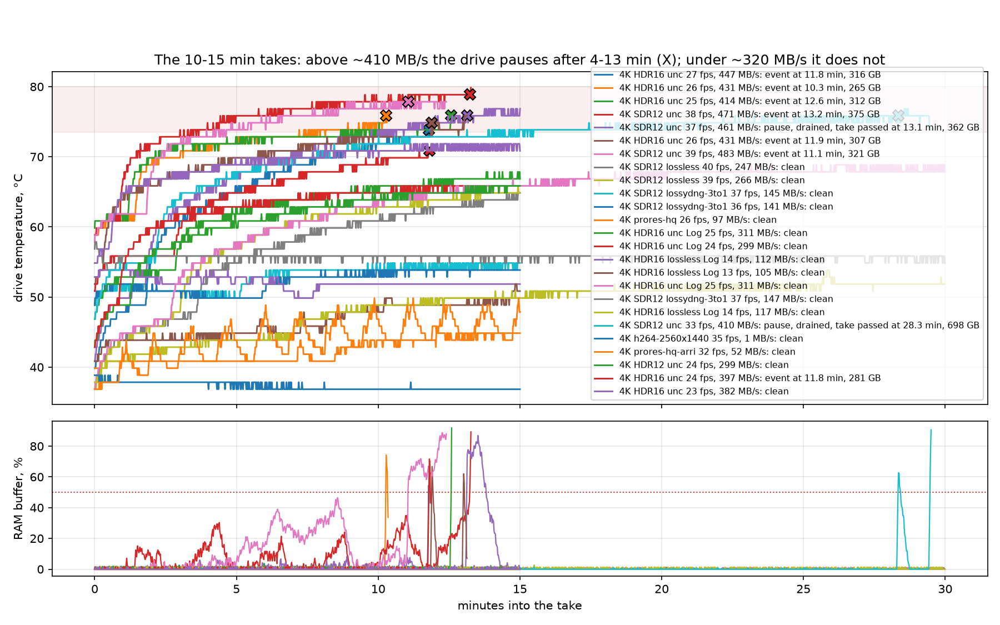
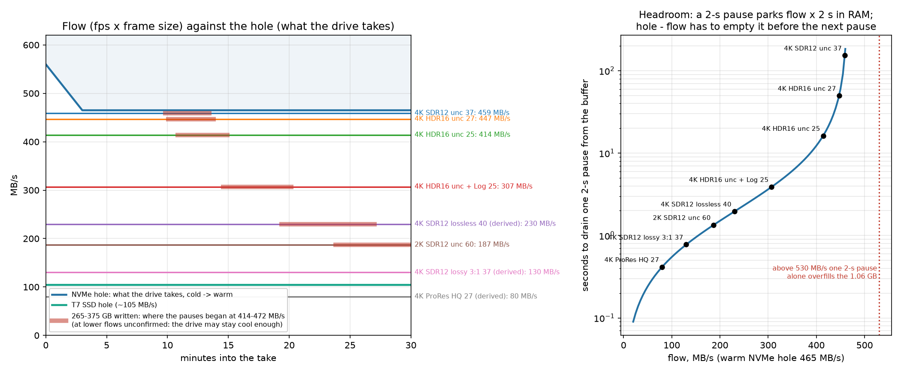
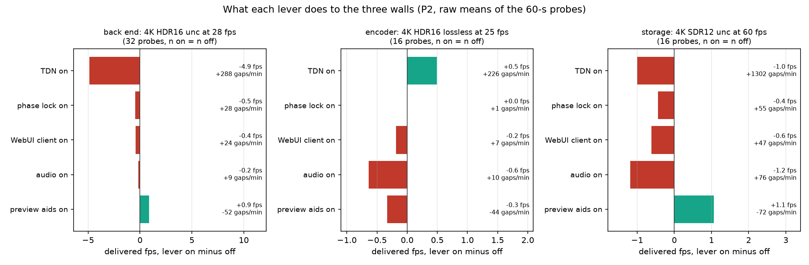

# Pre-analysis: sustained frame rate per mode, NVMe and SSD (2026-11-21)

Updated 2026-11-23 with the warm-drive 15-min takes (P6, P6b) and the 30-min and limit-search takes (P7, P8); the ladder block P4 is not in. The measured limits per cell, longest clean duration first, are in `measured-limits.md`. Labels:
**measured** (a take shows it), **derived** (computed from measured numbers), **probable** (the best reading of the
evidence), **unconfirmed**.

Data used:
- NVMe, Corsair MP600 Mini on the CFE hat:
  - estimator set `EST-05fb8f1-a`: 143 probes of 60 s on clip-split 05fb8f1, single sensor, mic attached (P0, P1, P1b, P2) and 12 validation combinations (P3);
  - the clip-split 7e6e2a3 set `est`: 56 probes;
  - the NVMe nights' 3-, 5- and 15-min takes (S2, S4, ARMS; `../nvme-campaign/findings.md`).
- SSD, Samsung T7 over USB (2K modes only, older build b755383, `../ssd-campaign/README.md`): nights 1-2, including 30-min takes, split and flat.

Raw: `../nvme-campaign/run-20261110/est-05fb8f1-a/` (probes.jsonl, validation.jsonl, estimate.md / estimate-table.csv).

## 1. The table

Capacity = what the 60-s probe sustained at the reference levers (TDN off, lock off, WebUI on, audio on, aids on):
- **cap**: the rate the writers kept up with, taken from the RAM buffer's fill slope or Core's write stats;
- **delivered**: frames that reached the recorder per second, when frames were lost before it.

Sustained = what a long take holds. The table rounds down for the ~2 fps a warm drive costs.

| Mode / format | NVMe 60-s capacity (measured) | NVMe long take (measured) | Limited by | Drops came from | Expected sustained NVMe | Expected sustained T7 SSD | Comment |
| --- | --- | --- | --- | --- | --- | --- | --- |
| 4K HDR16 uncompressed | 28 clean; 30: 51-65 dropped | 27-28 carried 3+5 min; 15 min: 27 and 26 dropped, 25 buffer full, 24 dropped at 712 s, **23 passed 15 min** (P8) | back end at 30, warm drive at 25-27 (~420-470 MB/s) | capture gaps at 30; buffer full from warm-drive pauses after ~10 min | 27 up to ~5 min; **23** for 15 min (measured) | ~6 (derived: 105 MB/s / 16.6 MB) | Heat and drive cache set the limit: 27 for short takes; for 15 min use HDR16 + Log 25 (below). |
| 4K HDR16 uncompressed + Log | 25.5-26.3 delivered | **25 passed 30 min** (P7, 560 GB, drive 71 °C); 24 and 25 passed 15 min | back end (Log costs ~40-50 % Core CPU) | capture gaps (95-260/min at 28-30) | **25** (measured, 30 min) | ~6 | The 4K HDR16 for long takes: at ~311 MB/s the drive never paused. |
| 4K HDR16 lossless | 14.6-15.5 | 25: buffer full at 12-13 s | encoder (CPU ~190 %) | buffer full | **14** (derived) | ~10 (derived, ~10 MB/frame) | Slow encoder: on NVMe uncompressed is better; lossless pays only where storage is the limit (T7). |
| 4K HDR16 lossless + Log | 30 "fit", but 240-526 dropped | out at 25; **14 passed 30 min** (P7), 13 and 14 passed 15 min | encoder | capture gaps above the wall | **14** (measured, 30 min) | ~10 | The probe's 30 was a misreading; 14 holds, drive ≤ 54 °C. |
| 4K HDR16 MLV | 27-28 | - | storage / back end | buffer full, capture gaps | ~26 (derived) | ~6 | Untested long; one file saves the folder cost, but ~430 MB/s heats the drive like uncompressed. |
| 4K HDR12 uncompressed | 26.0-26.5 delivered | P8: **24 passed 15 min** (269 GB); 26, 28, 30 dropped within 5 s | back end | capture gaps (200-230/min at 30) | **24** (measured, 15 min) | ~8 | Back end: 25+ drops frames. At 24 it holds; HDR16 + Log does better (25, 30 min).
| 4K HDR12 lossless | 30 "fit", 121-268 dropped | - | back end | capture gaps | ~24 (probable) | ~12 | The probe's "fit" is wrong (it dropped); treat as ~24 until a long take is run. |
| 4K HDR12 MLV | 23.4-26.2 | - | back end | capture gaps, buffer full | ~23 | ~8 | Back end limits it like HDR12 uncompressed; no reason to pick it over HDR16. |
| 4K SDR12 uncompressed | 40.5-49.9 (cold 520-580 MB/s) | 38: buffer full at 95-800 s; **37 passed 15 min** | storage (~460-475 MB/s warm) | buffer full | **37** (measured, 15 min) | ~8 (105 MB/s / 12.4 MB) | Best-proven 4K: 37 held 15 min; 38 and up runs into the drive. |
| 4K SDR12 lossless | 40.8-42.3 | 43 passed 3+5 min (S2, 7e6e2a3); **40 and 39 passed 15 min** (P6); **40 filled the buffer at 300 s in the 30-min take** (P7, drive started 49 °C) | encoder (CPU ~200 %) | buffer full | **40** (measured, 15 min) | ~18 (derived, ~5.7 MB/frame) | Half the write rate (~230 MB/s), the drive stays cool: the safe 4K pick for long takes. |
| 4K SDR12 lossy 3:1 | 37.9-40.8 | **37 and 36 passed 15 min** (P6); **37 passed 30 min** (P7, 239 GB, drive ≤ 60 °C) | encoder (CPU ~230 %) | buffer full | **37** (measured, 30 min) | ~30 (derived, 3.5 MB/frame) | No gain over lossless on NVMe; on the T7 it buys ~30 against ~18. |
| 4K SDR12 lossy 5:1 | 43 | - | encoder | buffer full | 41 (derived) | ~41 (encoder, 2 MB/frame fits) | Highest 4K SDR12 rate and it fits the T7; the image cost of 5:1 is not assessed. |
| 4K SDR12 MLV | 25.7-26.0 at 311-316 MB/s | - | MLV writer (one file, CPU 69 %) | buffer full | ~25 (probable) | ~8 | The MLV writer tops out near 25; cDNG beats it on NVMe. |
| 4K SDR10 uncompressed | 43.8-46.6 | - | back end / storage | buffer full, capture gaps | ~43 | ~10 | Short probes only; 10-bit buys ~4-6 fps over 12-bit. |
| 4K SDR10 lossless | 45.6-47.4 | P8: 45 clean 60 s, but **buffer full at 66 s (45) and 179 s (44)** | encoder | buffer full | **not found** (< 44) | ~20 | The 60-s probe misleads; the limit is lower and open.
| 4K SDR10 lossy 3:1 / 5:1 | 41 / 44 | - | encoder | buffer full | 39 / 43 | ~35 / ~43 | SDR12 lossy plus ~2 fps; untested long. |
| 4K SDR10 MLV | 10.8-11.1 at 116-120 MB/s | - | MLV writer | buffer full | **unconfirmed** (11 looks wrong: SDR12 MLV does 26) | - | Don't trust the 11: the probe hit the safety stop within seconds; re-measure first. |
| 2880x2160 crop SDR12 uncompressed / lossless | 53 / 59 | - | storage / encoder | buffer full | 51 / 56 (derived) | ~11 / ~24 | The near-4K route to 48-50 fps; untested long. |
| 4K ProRes HQ (standard colour) | 28.2-29.3 delivered | 27: 1 dropped at 12 s; 26 passed 15 min (P6), **26 dropped at 20 s in the 30-min take** (P7) | encoder (CPU ~340 %) | ProRes queue full + capture gaps | **25** (26 is marginal; measured 15 min at 26) | **~22** (derived from the measured 4.5 MB/frame: 130 MB/s at 28.6 fps, over the T7's 105) | The encoder sets 26 on NVMe; on the T7 the drive sets ~22. |
| 4K ProRes HQ ARRI LogC4 | 42.4-43.8 delivered (misread) | P3 at 46, P6b at 41, 40 and P8 at 36 dropped within 3 s; **32 passed 15 min** (P8) | encoder / back end | capture gaps | **32** (measured, 15 min) | ≤ 22 | Faster than standard HQ (32 against 26), cause unconfirmed.
| 4K ProRes 422 / LT / Proxy | 41.5 / 43.8-44.9 / 47.2-47.5 | - | encoder (CPU 220-300 %) | capture gaps | 40 / 43 / 45 | same | Encoder limit; 422 is the high-fps 4K ProRes choice. |
| H.264 2560x1440 | 47.1-47.5 delivered (misread) | P6 at 45, 44 and P8 at 40 dropped within 2 s; **35 passed 15 min** (P8) | back end / encoder | capture gaps | **35** (measured, 15 min) | same | Capture gaps above ~36; the Pi 5 has no 4K H.264.
| H.264 1920x1080 | 60 clean | P3 with TDN + lock: dropped at 60 | sensor (60) | with TDN on: capture gaps | 60 (TDN off) | 60 | 60 works with TDN off; TDN on drops frames. |
| 2K HDR16 uncompressed / lossless / Log / MLV | 30 (the mode's top) | - | sensor | none | **30** | uncompressed ~18 (measured meter); lossless 27 passed 30 min (measured) | The sensor sets the limit: any format works on NVMe; on the T7 use lossless. |
| 2K SDR12 uncompressed | 60 | - | sensor | none | 60 | **32** (measured, split, 4 x 30 min) | On the T7 the 32 needs the split take; lossless goes higher. |
| 2K SDR12 lossless / lossy / MLV | 60 | - | sensor | none | 60 | lossless 48 passed 30 min (measured); lossy ~60 (derived) | Best 2K on the T7: lossless 48 proven for 30 min. |
| 2K ProRes HQ / 422 / Proxy | 60 | - | sensor | none | 60 | 60 | No limit seen; the same on any storage. |
| 2K ProRes LT | 59.95 (1 gap) | - | sensor | one capture gap | 60 (probable) | 60 | One gap in 60 s, probably noise; re-check before calling it a limit. |

All NVMe capacities are measured on 05fb8f1. The SSD column is derived for 4K: the T7 sustains ~100-105 MB/s during
takes (measured) and was never tested in 4K.

## 2. Switches (levers): what they cost

P2 ran a 16-run design (2^(5-1)) on three anchors: back end (HDR16 uncompressed at 28, twice), encoder (HDR16
lossless at 25) and storage (SDR12 uncompressed at the top). Effects are mean(on) - mean(off), derived.

| Switch | Back end (capture gaps per minute) | Encoder / storage | Reading |
| --- | --- | --- | --- |
| **TDN (preview temporal denoise)** | **+288** (both repeats agree; noise SE 13) | "+0.25 / +0.32" on log capacity | **The one lever that matters.** It costs about 290 lost frames a minute at the HDR16 edge. The positive capacity number is probably an artefact: frames lost before the recorder never reach the writers, so the buffer fills more slowly and the meter reads high. |
| Phase lock | +24 to +31 | +0.12 storage, ~0 encoder | A small cost at the edge (about 2 SE). |
| Preview aids (peaking + zebra) | -47 to -58 | ~0 | Fewer gaps with the aids on (unconfirmed why); no reason to turn them off. |
| Audio recording (WAV) | +4 to +14 | +0.09 storage | Small. |
| WebUI connected | +9 to +39 | ~0 | Small; the second back-end run reads higher. |
| TDN x aids | -39 to -48 | -0.06 | The largest interaction; it partly offsets TDN. |

## 2a. The lever matrix (mode group x lever x storage)

Each cell: **NVMe | T7 SSD**.

| Mark | Meaning |
| --- | --- |
| ⛔ decisive | turns clean takes into dropped ones at any fps tried |
| ▲ costs | a few frames a minute, only within ~1 fps of the edge |
| ✚ helps | slightly fewer lost frames |
| ○ none | no measurable effect |
| — | the mode does not run there |

NVMe cells are measured (lever design and validation); T7 cells are derived (no lever tests on the SSD) unless marked.

| Mode group (what limits it) | Modes | TDN | Phase lock | Audio (WAV) | WebUI | Aids (peaking + zebra) | Log | Split 5000 |
| --- | --- | --- | --- | --- | --- | --- | --- | --- |
| **4K, back end** (ISP / CPU near its edge) | HDR16 uncompressed 25-28, HDR12 all formats, HDR16 + Log | ⛔ \| ⛔ | ▲ \| ○ | ▲ \| ○ | ▲ \| ○ | ✚ \| ○ | ⛔ −2 to −3 fps \| ○ | ○ in 15 min; ⛔ past ~30-50 min \| — |
| **4K, encoder** (compression CPU) | HDR16 / SDR12 / SDR10 lossless, lossy 3:1 and 5:1, crop lossless, ProRes all, H.264 1440 | ⛔ \| ⛔ | ○ \| ○ | ○ \| ○ | ○ \| ○ | ○ \| ○ | ⛔ in HDR16 lossless (hundreds/min) \| ○ | ○ (cDNG/lossy, short) \| ⛔ for long takes |
| **4K, drive** (write rate) | SDR12 / SDR10 uncompressed, crop uncompressed, MLV | ⛔ \| ⛔ | ○ \| ○ | ○ \| ○ | ○ \| ○ | ○ \| ○ | n/a (SDR) | ○ in 15 min \| — (4K uncompressed doesn't fit the T7) |
| **2K, sensor top** (NVMe) / **drive** (T7) | every 2K mode | ○ (5 of 5 clean at 60 with TDN on) \| ○ probable | ○ \| ○ | ○ \| ○ | ○ \| ○ | ○ \| ○ | ○ (HDR16 Log at 30 clean) \| ○ | ○ \| **⛔ measured**: flat 30 min failed 2 of 3, split passed 4 of 4 |
| **One-file formats** | MLV, ProRes, H.264 | as their group above | | | | | n/a | n/a (no folder) |

**Reading the matrix:**
- **TDN is the only lever that decides clean or not, and only when the sensor runs 4K.** On the T7 4K runs at 6-18 fps,
  below anything tested with TDN on (23 fps lowest). The ⛔ there is probable: TDN's cost is in the back end, whatever
  the drive.
- **Phase lock, audio and WebUI only count at a back-end edge**, which only the NVMe reaches in 4K. On the T7 the drive
  limits first, so the back end is never near its edge (derived).
- **Aids:** slightly fewer gaps with them on at the back-end edge (measured, why unconfirmed); no effect elsewhere.
- **Split:** the T7 needs it already at 2K for 30 min (measured). On the NVMe it stays on for every cDNG take, and it
  becomes decisive past the flat-folder time t* = 1.9e6 / fps² s.

**Best setup by storage:**

| Storage | Always | At the edge | Leave as you like |
| --- | --- | --- | --- |
| NVMe (MP600 Mini) | TDN off in 4K; split 5000 for cDNG / lossy | 4K HDR16 / HDR12 / Log: lock off, record audio only if needed, no WebUI client; aids on | everything at 2K; aids, audio, WebUI in encoder- or drive-limited modes |
| T7 SSD (USB) | split 5000; TDN off in 4K | — (the drive limits before the back end) | every lever at 2K |

## 2b. When each switch matters

Read from the lever design's 48 takes, split by what limits the mode (P2). The anchors:
- **back end**: 4K HDR16 uncompressed at 28, about 1 fps under its edge;
- **encoder**: 4K HDR16 lossless at 25, above its capacity of 15;
- **storage**: 4K SDR12 uncompressed at 60, above the drive.

Plus the 12 validation takes and the first-block probes. "Clean" = 0 frames dropped in 60 s.

| Switch | Matters when | Doesn't matter when | Evidence |
| --- | --- | --- | --- |
| **TDN** | **Any 4K sensor mode**, every format, any distance from the edge. With TDN on, 0 of 24 design takes were clean, against 16 of 24 with it off. 4K HDR16 at 25 dropped 173 frames (about 3 fps under its edge). 4K HDR16 at 23 and 4K HDR12 MLV at 23 dropped. Even H.264 1080p, which reads the 4K sensor, dropped at 60. | **2K**: every TDN-on take at 2K was clean (5 of 5). That covers SDR12 uncompressed at 60, lossy 5:1 at 60, ProRes 422 and Proxy at 60, and HDR16 lossless + Log at 23. | measured. Mechanism probable: the preview denoise runs in the ISP back end on the 4K input, and its time pushes the back end past the frame period; frames are then lost before the recorder, and Core's CPU *falls* (147 % vs 221 %) because less arrives. |
| **Phase lock** | Only within about 1 fps of a **back-end edge** (4K HDR16 at 28 with TDN off): 7-24 gaps per minute on against 1-4 off, and the takes that dropped 6-67 frames had it on. | Encoder-limited (HDR16 lossless: 8 of 8 clean with TDN off, lock on or off). Storage-limited (the buffer fills at the same rate). 2K. | measured, small n (4 + 4 per anchor) |
| **Audio recording (WAV)** | The same as the lock: near a back-end edge, +3 to +25 gaps per minute. One extra writer thread, about 10 % more Core CPU at the edge. | Encoder- or storage-limited, 2K. | measured, small n |
| **WebUI connected** | Near a back-end edge: +6 to +15 gaps per minute. | Elsewhere. | measured, small n |
| **Preview aids (peaking + zebra)** | Near a back-end edge it *helps*: fewer gaps with the aids on (0-9 against 8-19 gaps per minute). | Elsewhere. | measured; why unconfirmed (the aids may change the preview's path or rate) |
| **Log** (a format setting, not a lever) | 4K HDR16: about -2 to -3 fps and capture gaps (uncompressed 28 -> 25-26; lossless + Log drops hundreds a minute). | 2K HDR16: Log at 30 is clean. | measured |
| **Split (frames_per_folder 5000)** | Long cDNG takes: on any drive past t* = 1.9e6 / fps² seconds flat (50 min at 25 fps, 14 min at 48, 9 min at 60). On the T7 already at 2K 32 fps for 30 min. | MLV, ProRes and H.264 (one file); short takes. | measured (T7) + derived |

**In one line:** in 4K, TDN off is the rule; it decides clean or not at any fps. The other switches only count within
about 1 fps of a back-end edge (4K HDR16, 4K HDR12, 4K Log). There, lock, audio and WebUI each cost a few frames a
minute and the aids help a little. When the drive or the encoder limits the mode, only the fps and the format count.
At 2K, nothing measured here matters.

## 2c-0. NVMe temperature, sustained writes, and what failed the long takes

From the 1 Hz samples of every NVMe take of 3 min or longer. The temperature is the drive's own SMART reading, the
rate is device sectors written. "First event" = the RAM buffer above 50 %, or the first drop.

| Take | Rate | Drive temp start -> max | Clean sustained writing | Written before the event | Temp at the event | Outcome |
| --- | --- | --- | --- | --- | --- | --- |
| 4K HDR16 unc 27 fps, 15 min | 447 MB/s | 40 -> 75 °C | **707 s** | 316 GB | 73.9 °C | 3 dropped at 708 s |
| 4K HDR16 unc 26 fps, 15 min | 430 MB/s | 59 -> 76 °C | **616 s** | 265 GB | 75.9 °C | 2 dropped at 621 s |
| 4K HDR16 unc 25 fps, 15 min | 414 MB/s | 60 -> 76 °C | **755 s** | 312 GB | 75.9 °C | buffer full at 758 s |
| 4K SDR12 unc 38 fps, 15 min | 472 MB/s | 59 -> 80 °C | **795 s** (small pauses from 662 s) | 375 GB | 78.9 °C | buffer full at 799 s |
| 4K SDR12 unc 37 fps, 15 min | 459 MB/s | 41 -> 77 °C | **904 s, the whole take** (pauses at 661 and 787 s drained) | 362 GB at the first pause > 25 % | 75.9 °C | **passed** |
| 4K HDR16 / SDR12 at 27-38 fps, 3 and 5 min (11 takes) | 439-467 MB/s | 34-63 -> 62-76 °C | 180-300 s | 81-142 GB | - | all clean |
| 4K SDR12 unc 39 fps, 3 and 5 min | 475 MB/s | 47 -> 67 °C | 105-146 s | ~58 GB | 64.9 °C | buffer full: **above the drive's rate, not heat** |
| 4K HDR16 unc 28 fps, 3 min (one of six) | 456 MB/s | 50 -> 70 °C | 160 s | 73 GB | 67.9 °C | dropped: a capture gap (back end), not the drive |
| 4K HDR16 + Log 25 fps, 3 and 5 min | 307 MB/s | 34-52 -> 49-66 °C | 180-300 s | 56-94 GB | - | clean |
| 4K SDR12 lossless 29-44 fps, 3 and 5 min | 172-239 MB/s | 50-63 -> 60-65 °C | 180-300 s | 32-72 GB | - | clean; the drive stays under 66 °C below ~240 MB/s |
| P6: 4K HDR16 unc 27 / 26, 15 min | 446 / 430 MB/s | 39 / 52 -> 69-75 °C | 426 / 714 s | 190 / 307 GB | 68.8 / 74.8 °C | dropped at 432 / 788 s |
| P6: 4K SDR12 unc 39 / 38, 15 min | 484 / 468 MB/s | 58 / 57 -> 73-78 °C | 663 / 231 s | 321 / 108 GB | 77.8 / 72.8 °C | buffer full at 750 / 269 s |
| P6: 4K SDR12 lossless 40 / 39, 15 min | ~250 MB/s | 37 -> 67-68 °C | 900 s | 222-239 GB | - | **passed** |
| P6b: 4K HDR16 unc + Log 25 / 24, 15 min | ~300-311 MB/s | 47-51 -> 66-69 °C | 900 s | 269-280 GB | - | **passed** |
| P6: lossy 3:1 37/36, ProRes HQ 26, P6b: HDR16 lossless + Log 14/13, 15 min | ≤ 120 MB/s | 40-53 -> 46-57 °C | 900 s | ≤ 108 GB | - | **passed** |

What caused the dropped frames in the long takes:
- **The drive stopped taking writes for about 2 s at a time** (measured). The buffer went from empty to 700-900 MB in
  2-3 s, at an unchanged frame rate and with the 1-min write rate flat. When one pause overflowed the 1.06 GB to
  Core's safety stop, the take ended "buffer full". When it starved the copy path first, capture gaps came and frames
  were dropped.
- **When the pauses start** (measured): after **4-13 min of sustained writing at 414-484 MB/s**, with
  **108-375 GB written in the take**, at a drive temperature of **69-79 °C**. P6 brought the low end down: a drive
  already warm from the take before paused after 108 GB (SDR12 38, started at 57 °C).
- **Under ~320 MB/s few takes paused, but one did** (measured, P6/P6b/P7): HDR16 + Log at 311 MB/s wrote 560 GB in 30 min to 71 °C
  and stayed clean; lossless at ~250 MB/s passed 15 min twice, then filled the buffer at 300 s in a 30-min take that followed a 560 GB one (drive started 49 °C). So the write rate
  matters most, but the drive's state at the start counts: probable that the cache folding keeps up below ~320 MB/s only on a drive that has had time to recover.
- **Not temperature alone** (measured). 5-min takes at the same rates reached 74-76 °C with 135-142 GB written and
  stayed clean. Before P6 every failure came after at least 265 GB; P6 had one at 108 GB, on a drive started warm.
- **Probable mechanism:** the drive's fast write cache (SLC) running out within the take, made worse by heat. The
  drive then has to fold the cache into slower flash while it keeps writing, and it pauses. Which of the two dominates
  is unconfirmed: no take separated "hot but under 265 GB" from "past 265 GB but cool".
- **The longest clean sustained writing** was 904 s, 362 GB at 459 MB/s (4K SDR12 37 fps; it survived two pauses).
  For 4K HDR16 it was 755 s, 312 GB at 414 MB/s.
- **Below ~240 MB/s** (lossless, lossy, ProRes) the drive stayed at 60-66 °C over 5 min and never paused (measured,
  short takes only).
- The Pi stayed at 52-66 °C in every take: no Pi throttling in these takes (measured).
- **Between takes** the drive cooled back to 40-63 °C. How long the cache takes to recover idle is unmeasured; that
  matters for back-to-back long takes.

## 2c-1. The picture: flow, the hole, and the walls

Figures from `scripts/figures.py` (re-run it on new data). Labels: measured unless marked.

**Two quantities decide a long take:**
- **Flow** = fps x frame size: what the camera pushes, MB/s. The frame size comes from the mode: resolution x bit depth,
  divided by the compression.
- **The hole** = what the storage takes, sustained, at its current state. NVMe ~560 MB/s cold, ~465 warm; after
  265-375 GB written at 74-79 °C it pauses for ~2 s at a time. T7 SSD ~105 MB/s.

A take holds while flow < hole, and while the RAM buffer (1.06 GB) can bridge the drive's pauses. Before the drive,
two CPU walls can come first: the **back end** (every frame copied out of the camera; HDR, Log and TDN cost here) and
the **encoder** (lossless, lossy, ProRes and H.264 move the load from the drive to the CPU).

**Which wall a mode reaches first.** The storage walls are drive MB/s / frame size. The CPU walls are measured. The
lowest one is the mode's limit. It moves: the drive's wall drops as it warms and fills (blue -> red), the CPU walls
move with the levers, and the T7's wall (green) sits low for every 4K mode except lossy 5:1. On the right, per mode: the limit, and how long a take records
clean at the recipe's fps on each storage (from 2c-0, 2c and 5a; measured where it says so).

| Mode | MB per frame | Flow at its fps |
| --- | --- | --- |
| 4K HDR16 uncompressed | 16.6 | 415 MB/s at 25, 447 at 27 |
| 4K HDR12 / SDR12 uncompressed, MLV, HDR16 + Log | 12.4-12.5 | 459 at 37 (SDR12); 307 at 25 (Log) |
| 4K HDR16 lossless | 11.8 | ~165 at 14 |
| 4K SDR10 uncompressed | 10.4 | ~470 at 45 |
| 2880x2160 crop SDR12 uncompressed | 9.3 | ~465 at 50 |
| 4K SDR12 lossless / lossy 3:1 / lossy 5:1 | 5.0 / 3.4 / 2.0 | ~200 / ~130 / ~85 at 40 / 37 / 41 |
| 2K HDR16 / SDR12 uncompressed | 4.2 / 3.1 | 125 at 30 / 187 at 60 |
| 4K ProRes HQ / 422 / LT / Proxy (measured write rate / delivered fps) | 4.5 / 1.8 / 0.9 / 0.2 | 130 at 28.6 / 74 at 41 / 40 at 44 / 10 at 47 |
| H.264 | < 0.1 | under 1 MB/s on the device counter |

**How much a mode warms the drive.** The warming follows the flow:

| Mode group | Flow MB/s | Drive rise in the first minute (median) | Peak in takes of 3 min+ |
| --- | --- | --- | --- |
| 4K uncompressed cDNG | 310-524 | 13 °C | 61-80 °C |
| 4K uncompressed + Log | 311-327 | 9 °C | 49-66 °C |
| 4K lossless / lossy cDNG | 105-278 | 7 °C | 60-65 °C |
| 4K ProRes / H.264 | 0-131 | 1.5 °C | - (60-s probes only) |
| 2K, every format | 3-187 | 2 °C | 42-64 °C |

**What happens in a long take** (the 10-15 min takes). The drive climbs 30-35 °C in the first 2-3 min, then creeps
toward 72-79 °C. The first real pause (buffer above 50 %) came at 10.3-13.2 min, after 265-375 GB. Smaller backlogs
(10-35 %) came and drained well before that in the 38-fps take.

**Why a flow just under the hole is the fragile one** (derived). A 2-s pause parks flow x 2 s in RAM. Only the spare
rate (hole - flow) empties it. At 4K SDR12 37 (459 MB/s) one pause takes ~2.5 min to drain; at 4K HDR16 25, ~16 s; at
4K SDR12 lossless 40, ~2 s. When pauses come faster than the buffer drains, they stack until the safety stop. The left
panel shows each mode's flow over a take, and where it reaches the 265-375 GB at which the pauses began. That they
also begin at low flows is unconfirmed: a cool drive may never pause.

**How the levers move the walls** (P2: raw means of the 60-s probes, the frames that reached the recorder):
- **TDN** is the big one. On the back end it costs **-4.9 fps** and **+288 capture gaps/min**. On the storage anchor it
  adds +1302 gaps/min. TDN loses frames before the drive: the flow drops, so the drive looks relieved. It never gains
  anything.
- **Phase lock** -0.5 fps on the back end; **WebUI client** -0.4 to -0.6; **audio** -0.2 to -1.2. Each is about one
  fps, which matters only when the mode sits within 1 fps of a wall.
- **Preview aids on** +0.9 / +1.1 fps (fewer gaps). Unconfirmed why; the full analysis checks the sign.

## 2c-2. Which modes hold 25 fps for 30 min?

Flow at 25 fps = 25 x the frame size (2c-1). It has to stay under the drive's sustained rate with room for the warm
pauses, and under the mode's CPU wall with ~1 fps to spare. Nothing in 4K has run 30 min yet: "probable" is derived
from 2c and 2c-0.

| Mode at 25 fps | Flow | NVMe 30 min | T7 30 min | Why |
| --- | --- | --- | --- | --- |
| 4K HDR16 uncompressed | 415 MB/s | **no**: 25 failed at 12.6 min (measured) | no | the drive pauses after ~312 GB |
| 4K HDR16 uncompressed + Log | 311 MB/s | **yes, measured**: 25 passed 30 min, 560 GB, drive 71 °C (P7) | no | under the drive's pause rate; back end 1 fps from its wall |
| 4K HDR16 MLV | ~415 MB/s | no (as uncompressed) | no | the same flow |
| 4K HDR16 lossless (± Log) | ~295 MB/s | **no**: the encoder tops out at 14 (+ Log: 14 passed 30 min, P7) | no | encoder |
| 4K HDR12 uncompressed / lossless / MLV | 310 MB/s | **no**: the back end dropped at 25-30 (measured); uncompressed holds 24 for 15 min (P8) | no | back end |
| 4K SDR12 uncompressed | 310 MB/s | **probable**: 33 reached 29:51 of 30 min (P7, 727 GB); 25 is far under that | no | ~560 GB in 30 min: past 265 GB, but with 155 MB/s to spare |
| 4K SDR12 lossless | ~155 MB/s | **probable** at 25; 40 passed 15 min twice but filled the buffer at 5 min in the 30-min take (P7) | no (T7 tops ~18) | a drive started warm costs the lossless 40 |
| 4K SDR12 lossy 3:1 | ~85 MB/s | **yes, measured**: 37 passed 30 min (P7) | **probable** | under the T7's ~105 MB/s |
| 4K SDR12 lossy 5:1 | ~50 MB/s | **probable** | **probable** | |
| 4K SDR12 MLV | 310 MB/s | uncertain: 25 is the MLV writer's limit (25.7-26) | no | the writer, not the drive |
| 4K SDR10 uncompressed | ~260 MB/s | **probable** | no | |
| 4K SDR10 lossless / lossy | ~105 / < 90 MB/s | **probable** | lossless marginal; lossy **probable** | |
| 2880x2160 crop SDR12 lossless | ~95 MB/s | **probable** | probable at 24, marginal at 25 | |
| 4K ProRes HQ | ~112 MB/s | **probable** at 25; 26 passed 15 min but dropped at 20 s in the 30-min take (P7) | no (T7 ~22) | 4.5 MB/frame |
| 4K ProRes 422 / LT / Proxy | 45 / 22 / 5 MB/s | **probable** | **probable** | encoder far above 25 |
| H.264 1080p | < 1 MB/s | **probable** | **probable** | |
| H.264 2560x1440 | < 1 MB/s | **probable** at 25: 35 passed 15 min (P8) | probable | back end, not storage |
| 4K SDR12 + Log (lossless or uncompressed) | 100-250 MB/s | **no**: dropped at 30, 33, 36, 37, 40 (copy slots full, P8) | no | the Log decode on the copy workers |
| 2K HDR16 uncompressed | 105 MB/s | **probable** | no (18 fps measured) | at the T7's own rate |
| 2K HDR16 lossless | ~55 MB/s | **probable** | **passed** at 27 (measured, older build) | |
| 2K SDR12 every format | ≤ 78 MB/s | **probable** | **passed**: uncompressed 32 and lossless 48 (measured, older build) | |

**In short:** for 4K HDR at 25 fps for 30 min on NVMe, **HDR16 uncompressed + Log is the one mode that held it**: 30 min
at 25, 560 GB, no drive pause (P7). Without Log, HDR16 fails at 7-13 min; HDR12 and MLV sit at their CPU limits.
Nothing 4K HDR works on the T7. For a 30-min 4K take at 25:
- **NVMe:** HDR16 + Log; SDR12 uncompressed, lossless or lossy; SDR10; ProRes HQ / 422.
- **T7:** only SDR12 / SDR10 lossy, ProRes 422 / LT / Proxy, or H.264.

## 2c. Will a 30-min take work? (projection)

P7 recorded 30 min in 4K for three modes (4K HDR16 + Log 25, 4K SDR12 lossy 3:1 37, 4K HDR16 lossless + Log 14); the rest of the table below is the projection made before it. The S6 flat controls never
ran. This is a projection from four measured facts:
1. Core's RAM buffer reaches its 90 % safety stop at about **1.06 GB** (1181 MiB x 0.9).
2. A warm NVMe (72-78 °C, from about 10 min in) **pauses writes for about 2 s**. The buffer jumped to 700-900 MB within
   2-3 s at 450 MB/s.
3. Between pauses the warm drive takes at least **~470 MB/s** (1-min rates in the 15-min takes).
4. The split caps the exFAT folder cost at 1.6 ms per file, so the folder no longer grows the load.

**Since 2c-0:** the pauses began only after 265-375 GB in one take. Modes above ~300 MB/s write that within 15-20 min, so their 30-min rows below are uncertain, not probable. Modes under ~240 MB/s stay cool and under ~430 GB in 30 min: probable.

So on NVMe a mode survives 30 min if (a) one pause fits in the buffer, which takes **pause tolerance = 1060 MB / data
rate > ~2.5 s** (about 420 MB/s or less), and (b) the buffer drains before the next pause, which takes
**470 MB/s - data rate** to be clearly above zero.

On the T7 the drive's steady ~100-105 MB/s is the limit (measured, 30-min takes passed at 2K). Its pauses were not
measured the same way.

| Mode | fps | Data rate | NVMe pause tolerance | NVMe 30 min | T7 30 min |
| --- | --- | --- | --- | --- | --- |
| 4K HDR16 uncompressed | 25 | 415 MB/s | 2.6 s, drain margin ~55 MB/s | **unlikely**: 25 already failed at 12.6 min (measured) | no (6 fps max) |
| 4K HDR16 uncompressed | 22-23 | 365-380 MB/s | 2.8-2.9 s, margin ~90-105 | **uncertain**: a 30-min take writes ~660 GB, far past the 265-375 GB where the pauses began (2c-0); one pause fits, a longer or denser run of them may not | no |
| 4K HDR16 + Log | 25 | ~311 MB/s (measured) | 3.4 s, margin ~160 | **probable**: 15 min passed with 280 GB and no pause (P6b) | no |
| 4K HDR16 lossless (± Log) | 14 | ~110-140 MB/s | 7.6 s | **probable**: + Log passed 15 min (P6b) | probable at ≤ 10 |
| 4K HDR12 uncompressed | ≤ 24 | ≤ 300 MB/s | 3.5 s | **uncertain**: the back end drops frames at any fps tried (25-30); 22-23 untested | no |
| 4K SDR12 uncompressed | 37 | 460 MB/s | 2.3 s, margin ~10 MB/s | **unlikely**: passed 15 min with two pauses (58 and 299 MB); the backlog grows as the drive heats | no |
| 4K SDR12 uncompressed | 33 | 410 MB/s | 2.6 s, margin ~60 | **uncertain**: ~740 GB in 30 min, past the 265-375 GB point; the margin over a 2-s pause is thin | no |
| 4K SDR12 lossless | 40 | ~250 MB/s (measured) | 4.2 s | **probable**: passed 15 min, drive to 67 °C, no pause (P6) | at ≤ 18 probable |
| 4K SDR12 lossy 3:1 / 5:1 | 37 / 41 | ~120 (measured) / ~85 MB/s | 8 / 12 s | **probable** (3:1 passed 15 min) | 3:1 at ≤ 28, 5:1 at ≤ 41: probable (85 MB/s under 100) |
| 2880x2160 crop SDR12 lossless | 56 | ~210 MB/s | 5 s | probable | ≤ 24 |
| 4K SDR12 MLV | 25 | ~310 MB/s | 3.4 s | uncertain-to-probable: ~560 GB in 30 min; one file, no folder cost | no |
| 4K ProRes HQ / 422 / LT / Proxy | 26 (15 min passed) / 40 / 43 / 45 | ~115-122 / ~72 / ~39 / ~10 MB/s (measured 4.5 / 1.8 / 0.9 / 0.2 MB/frame) | > 8 s | **probable**; the limit is CPU (220-340 %), not the drive; CPU heat over 30 min unmeasured | HQ only at ≤ 22 (the T7's ~105 MB/s); 422 / LT / Proxy probable |
| H.264 1080p | 60 | < 10 MB/s | - | probable (CPU) | probable |
| H.264 2560x1440 | not found (44 drops) | < 10 MB/s | - | uncertain | uncertain |
| 2K HDR16 uncompressed | 30 | 125 MB/s | 8.5 s | **probable** | no (18 fps meter); lossless 27: **passed 30 min** (measured) |
| 2K SDR12 uncompressed | 60 | 187 MB/s | 5.7 s | **probable** with the split (flat: t* = 9 min at 60 fps) | 32: **passed 30 min, 4 of 4, split** (measured) |
| 2K SDR12 lossless | 60 | ~95 MB/s | > 10 s | probable | 48: **passed 30 min** (measured) |

Two open risks for every 30-min projection:
- **CPU and Pi heat.** The 4K encoder modes run Core at 200-340 % CPU, and the Pi reached 55-65 °C in 60 s. Whether it
  throttles over 30 min is unmeasured.
- **The drive's pauses past 15 min.** They grew from 58 to 299 MB between 11 and 14 min; nothing says where they go
  after that.

P7 ran the 30-min takes (findings.md): 4K HDR16 + Log 25, 4K SDR12 lossy 3:1 37 and 4K HDR16 lossless + Log 14 passed; 4K SDR12 lossless 40 filled the buffer at 5 min, ProRes HQ 26 dropped at 20 s, and 4K SDR12 uncompressed 33 reached 29:51 before the buffer filled.

## 3. What caused the dropped frames

| Cause | Where it shows | Mechanism | Label |
| --- | --- | --- | --- |
| **Capture gaps** | 4K HDR12 (all formats), HDR16 at 30, any Log in 4K HDR16, 4K ProRes and H.264 1440, everything with TDN on | Frames never reach the recorder: the ISP / back end / copy path cannot keep the sensor's rate. Core CPU 250-340 % in those probes. | measured (counters); mechanism probable |
| **Buffer full** (Core's 90 % safety stop) | uncompressed SDR at the drive's limit, lossless and lossy in 4K, MLV | The writers (drive, or the compression CPU) are slower than capture; the 1.1 GiB RAM buffer fills in 8-17 s at 60 fps. | measured |
| **Warm-drive write pauses** (NVMe) | every 15-min take that failed (HDR16 25-27, SDR12 38), at 10-13 min | Once warm (72-78 °C) the drive stops taking writes for ~2 s; at 450 MB/s that is ~900 MB, which fills the buffer. The 1-min write rate stays flat. Thermal throttle or garbage collection: unconfirmed. | measured (samples); cause probable |
| **ProRes queue full** | 4K ProRes HQ at 60 | The encoder's own queue. | measured |
| **exFAT folder walk** (flat folders) | T7 30-min flat takes, NVMe prognosis | Each new file walks the folder: 0.32 µs x files already in it. A flat folder slows a long take until it stops; the 5000-frame split removes this. | measured (T7, NVMe probe) |
| Copy-slot drop at a part boundary | T7, 1 event (3 frames) | `mkdir` of the next part folder on the copy thread | probable, rare |
| Frame-number jump | T7, 1 event | Timestamp numbering, not a lost frame | probable, rare |

## 3b. The split take: why it works, and what it costs

**What it does.** With `frames_per_folder` = N (5000 by default), Core writes a take's frames into part folders
`part_001`, `part_002`, ... of N frames each, inside the clip folder. After the take the merge worker moves them back
into one folder (the merge is on), so the clip looks like a plain cDNG folder again.

**Why a flat folder fails a long take (measured on the T7 and in the NVMe probe; the formula is derived).**
- exFAT keeps a folder's entries in a list, with no index. Creating a file walks the whole list to check the name,
  under the file system's lock: W(n) = 0.32 µs x n, where n is the number of files already in the folder. The same slope
  was measured on both drives (317 ns NVMe probe, T7 S3).
- In a flat take n grows with time (n = fps x t), so the walk's share of the frame budget grows as
  s(t) = 0.32 µs x fps² x t. The campaign's rule is that a flat folder holds while s < 0.6. That gives
  t* = 1.9e6 / fps² seconds:
  - 50 min at 25 fps
  - 31 min at 32 fps
  - 14 min at 48 fps
  - 8.8 min at 60 fps
  - 3.2 min at 100 fps
- On the T7 this showed exactly. Core CPU climbed from 52-57 % to 125-131 % over flat 30-min takes, and two of three
  stopped at 29 min. With the split, CPU stayed at 50-58 % for 4 x 30 min, the buffer peaked at 7 %, and all were clean
  (measured).

**Why the split fixes it (derived).** No folder holds more than N files, so the walk is capped at 0.32 µs x N
= 1.6 ms per file at N = 5000. At 32 fps that is 5 % of the frame budget; at 60 fps about 10 %; at 100 fps 16 %. Each
part folder starts empty, so the cost no longer grows with the take's length.

**What it costs.**
- *A part boundary* every N frames: the next part folder is created (`mkdir`) on the copy thread. On the T7 one
  boundary out of ~40 stalled long enough (behind 30 queued UAS writes) that all six copy slots were busy, and 3 frames
  were refused (probable, n = 1). A fix, not built yet: create part k+1 from a writer thread, or ahead of time when part
  k starts.
- *The merge after the take*: 342 s for a 30-min 2K take of 45,000 frames (measured). The per-file time grows with the
  main folder, because the merge's moves walk the same list (0.8 ms per file early, 7.6 ms average). During a merge the
  campaign waits; a new take during a merge competes with it for the drive.
- *Deletes*: a folder with parts deletes in about linear time per part. A flat 30,000-frame folder took 157 s to
  delete on a cold drive (measured, NVMe EST day).

**On the NVMe in 4K (measured / probable).**
- 4K takes at 25-40 fps reach N = 5000 in 2-3.5 min, so a 15-min take has 4-7 parts.
- The 15-min failures were not at part boundaries. They came at 10-13 min as warm-drive pauses, with the buffer
  jumping from 0 to 700-900 MB within 2-3 s, so they are a drive effect, not a folder effect.
- The flat 30-min controls (S6) never ran: no mode passed 30 min with the split first. So "when does 4K need the split"
  is still derived only. At 4K's 25-40 fps the walk alone would allow 20-50 min flat, but the 4K CPU load (190-340 %)
  leaves less headroom than 2K had.

**Rule kept:** split at 5000 for every cDNG and lossy DNG take; MLV, ProRes and H.264 write one file per take and
don't need it.

## 4. Known errors in the estimator (why P3 met 6 of 12)

- The 60-s probes see a cold drive. Long takes on NVMe lose about 2 fps (SDR12: 39 -> 37) and more at HDR16 (measured).
- Lossless or lossy at the 4K HDR edge ("4kHDR16 lj:log 30", "4kHDR12 lj 30"): the fit reads 30 while hundreds of frames dropped. Delivered frames should cap it: model bug, probable.
- TDN combinations are overestimated: 3 of the 6 misses had TDN on (HDR16 unc, HDR12 MLV, H.264 1080 at 60). The model adds levers as main effects, and TDN's real cost on the back end is larger than its capacity term says.
- The capacity reading with TDN on is wrong (measured): TDN loses frames before the drive, so the buffer fills slower and the fit reads +4.4 fps (encoder anchor) and +15.5 fps (storage anchor), while the delivered fps fell by 1.0 on the storage anchor. The model must use delivered frames whenever capture gaps occur.
- Delivered frames over a dropping 60-s probe are not a limit (measured, P6): H.264 1440 (estimate 45) and ProRes HQ
  LogC4 (estimate 41) both dropped within 2 s at the estimate and one below. ProRes LogC4 does not beat standard HQ.
- The MLV SDR10 reading (11 fps): unconfirmed, to check against the raw takes.
- Below ~320 MB/s the estimate held 15 min warm at p or p-1 in every cell P6 ran (6 of 6); above ~410 MB/s it failed
  at both (3 of 3 cells): the warm penalty depends on the write rate.

## 5. Recommendations (best setup per use)

**Always:**
- TDN off while recording (the biggest single cause of lost frames).
- Split at 5000 frames, merge after the take.
- Phase lock only when you need it.
- Leave aids, audio and WebUI as you like.

| Use | NVMe (MP600 Mini) | T7 SSD |
| --- | --- | --- |
| 4K, best image, short takes | HDR16 uncompressed 27 for takes under ~7 min | not possible (6 fps) |
| 4K HDR, long takes | **HDR16 uncompressed + Log 25** (30 min proven); HDR16 lossless + Log 14 (30 min proven); HDR12 uncompressed 24 (15 min) | - |
| 4K SDR, long takes | SDR12 lossy 3:1 37 (30 min proven); lossless 39-40 and uncompressed 37 (15 min proven; lossless 40 failed a 30-min take at 5 min) | lossy 5:1 ~41 (derived) |
| 4K high frame rate | SDR12 lossless 40 / lossy 5:1 41 / crop 2880x2160 lossless 56 | lossy 5:1 ~41 (derived) |
| 4K delivery codecs | ProRes HQ 25-26 (26 passed 15 min, dropped in 30), 422 40, LT 43, Proxy 45; ProRes LogC4 32 (15 min proven); H.264 1440 35 (15 min proven) | ProRes HQ ~22 (the drive); 422 / LT / Proxy / H.264 the same as NVMe |
| 2K | everything at the mode's top (HDR 30, SDR 60) | SDR12 lossless 48, uncompressed 32 (split), HDR16 lossless 27 |

## 5a. Recipes per mode, and what to expect

**The base recipe, every mode:**
- TDN off.
- Split at 5000 frames, merge after the take.
- Phase lock off unless you sync to something.
- Aids on as you like (no cost).
- Audio on is fine, except within ~1 fps of a wall. There, also close WebUI clients you don't need.

For 4K on NVMe, one more rule: keep the write rate **under ~320 MB/s** for anything over a few minutes. Every 15-min
take under it passed (P6/P6b); every one above ~410 MB/s paused, after 4-13 min, whether the drive started at 40 °C
or 60 °C.

| Mode | Storage | Recipe (format, fps) | Expect | Confidence |
| --- | --- | --- | --- | --- |
| **4K HDR16** (best image) | NVMe | cDNG uncompressed **27** for takes up to ~5 min; **23** for 15 min; for 30 min use **+ Log 25** (next row) | 27: clean 3-5 min (11 of 12 takes); warm 15 min: 27 dropped at 7 min, 26 at 13 min, 24 at 12 min (P6, P8); 23 passed 15 min (343 GB) | measured |
| | T7 | HDR16 lossless **~9** (uncompressed only ~6) | not practical for 4K HDR16 | derived |
| **4K HDR16 + Log** | NVMe | cDNG uncompressed + Log **25** | **passed 30 min** at 25 (P7): 311 MB/s, 560 GB, drive to 71 °C, no pause. Above 25 the back end drops frames | measured (30 min) |
| | T7 | - (~8 fps) | not practical | derived |
| **4K HDR16 lossless** (± Log) | NVMe | lossless **14** | encoder-limited (CPU ~190 %); + Log **passed 30 min** at 14 (P7), drive ≤ 54 °C | measured (+ Log, 30 min) |
| | T7 | lossless **≤ 9** | ~105 MB/s; fits | derived |
| **4K SDR12 + Log** | NVMe | **not usable yet** | cDNG lossless or uncompressed with Log (decoded from the PiSP stream, Core f1e344a): dropped at 30, 33, 36, 37, 40 (copy slots all held within 0.7-7.7 s); the limit is below 30 and not found | measured (fails at 30) |
| **4K HDR12** | NVMe | cDNG uncompressed **24** | 24 **passed 15 min** (P8, 269 GB); 26, 28, 30 dropped within 5 s (back end). HDR16 + Log holds 25 for 30 min | measured (15 min) |
| | T7 | - | not practical | - |
| **4K SDR12** (most frames, raw) | NVMe | uncompressed **37** up to 15 min; **33** for longer | 37: **passed 15 min** (two pauses absorbed); 33: buffer full at 29:51 of 30 min (P7, 727 GB); 30 is probable | 37 measured (15 min); 33 measured, 9 s short |
| | T7 | use lossy 5:1 (below) | uncompressed only ~8 | derived |
| **4K SDR12 lossless** | NVMe | lossless **40** | **passed 15 min** at 40 and 39 (P6): ~250 MB/s, drive to 67 °C; **but filled the buffer at 5 min in the 30-min take** (P7, drive started 49 °C): use 36 or less for 30 min (not tested) | measured (15 min) |
| | T7 | lossless **≤ 18** | ~100 MB/s | derived |
| **4K SDR12 lossy** | NVMe | 3:1 at **37**, 5:1 at **41** | 3:1 **passed 30 min** at 37 (P7, 239 GB, drive ≤ 60 °C); 5:1 not run long | 3:1 measured (30 min); 5:1 derived |
| | T7 | **5:1 at 41** (best 4K on the T7); 3:1 at ≤ 28 | 5:1 at ~85 MB/s fits under the T7's ~105 | derived |
| **4K SDR10** | NVMe | lossless: **limit not found** (45 and 44 filled the buffer within 3 min; < 44); uncompressed 43 for short takes | uncompressed ~450 MB/s behaves like 4K SDR12 37 (pauses after ~10 min) | 45 measured to fail |
| | T7 | lossy 5:1 **~43** | | derived |
| **2880x2160 crop SDR12** | NVMe | lossless **56**; uncompressed 50 for short takes | lossless ~210 MB/s: cool, probable for 30 min | derived |
| | T7 | lossless **≤ 24** | | derived |
| **4K MLV (SDR12)** | NVMe | **25** | the MLV writer caps it; ~310 MB/s, one file per take; 30 min uncertain-to-probable | probable |
| | T7 | - | not practical | - |
| **4K ProRes** | NVMe | HQ **25** (26 is marginal), 422 **40**, LT **43**, Proxy **45**; LogC4 **32** | HQ 26 passed 15 min, dropped at 20 s in a 30-min take (P7); LogC4 32 passed 15 min (P8), 36 dropped; the encoder is the limit, not the drive | HQ and LogC4 measured (15 min); the rest derived |
| | T7 | HQ **22**; 422 **40**, LT **43**, Proxy **45** | HQ writes 4.5 MB/frame (measured), so the T7's ~105 MB/s sets ~22; the others fit; 30 min probable | derived |
| **H.264** | both | 1080p **60**; 2560x1440 **35** | 1080p 60 only with TDN off; 1440 at 35 passed 15 min (P8), dropped at 40 and above within 2 s | 1080p measured (60-s); 1440 measured (15 min) |
| **2K HDR16** | NVMe | any format at **30** (the sensor's top) | flow ≤ 125 MB/s; the drive stays ≤ 64 °C | measured |
| | T7 | lossless **27** | **passed 30 min** | measured |
| **2K SDR12** | NVMe | any format at **60** | 187 MB/s uncompressed; 30 min probable with the split | measured (60-s, 5-min) |
| | T7 | lossless **48**, uncompressed **32** with the split, lossy 5:1 ~60 | lossless 48 and uncompressed 32 **passed 30 min** | measured; lossy derived |

## 6. For the full analysis

- P6/P6b: done (findings.md). The measured limits per cell: `measured-limits.md`.
- Done in P7/P8: the 30-min takes for the 15-min rows, and the limits of H.264 1440 (35), ProRes LogC4 (32), 4K HDR12 (24), HDR16 (23). Open: 4K SDR10 lossless (< 44), the SDR Log limit (< 30), ProRes HQ at 25.
- P4: Dynamic resolution switching modes on fps changes (not run).
- Model fixes: cap the capacity at delivered frames when frames drop; give TDN its back-end term; the warm penalty from P6.
- Check against the raw takes: MLV SDR10, the aids effect's sign.
- The SSD in 4K: the column above is derived only (the user accepts the older build's SSD data).
